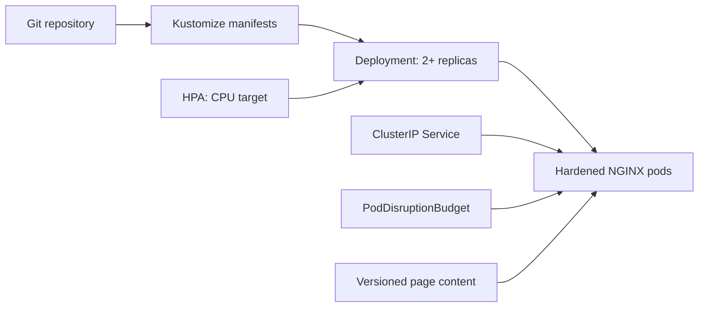

# Project 02 — Kubernetes application delivery

**Status:** Complete  
**Objective:** Deliver a small web application to K3s using production-oriented Kubernetes practices: declarative deployment, health probes, resource controls, availability protection, autoscaling, and rollback.

## Problem statement

A container running is not the same as an operable application. This project packages a lightweight web service so Kubernetes can determine when it is ready, restart it when unhealthy, roll out a new release without downtime, and scale it from measured CPU usage.

## Architecture



## Prerequisites

- Project 01 is applied: the `homelab` namespace, ResourceQuota, and LimitRange exist.
- `kubectl` targets the intended K3s context.
- Metrics API is available for the HorizontalPodAutoscaler.

## Design decisions and trade-offs

| Decision | Why | Trade-off |
| --- | --- | --- |
| Two initial replicas | Demonstrates availability during a rolling update and single-pod failure. | Uses more resources than a single demo pod. |
| `nginxinc/nginx-unprivileged` on port 8080 | Enables non-root execution without special privileges. | This is a static demo service, not application business logic. |
| Explicit resource requests/limits | Allows predictable scheduling and CPU-based HPA. | Limits must be tuned from observed usage over time. |
| HPA range 2–5 | Demonstrates autoscaling while staying within Project 01's namespace quota. | Low traffic will keep the workload at two replicas. |
| ClusterIP-only Service | No public endpoint or ingress is required yet. | External routing and TLS are deferred to Project 03. |

## Deploy

Run these commands from the repository root:

```powershell
kubectl config current-context
kubectl apply --dry-run=client -k ./manifests/
kubectl apply -k ./manifests/
kubectl rollout status deployment/hello-web -n homelab --timeout=120s
```

## Validate

```powershell
./scripts/validate.ps1
kubectl -n homelab get deployment,pods,service,hpa,pdb
kubectl -n homelab top pods
./scripts/smoke-test.ps1
```

## Release and rollback demonstration

After initial validation, change the `app.kubernetes.io/version` label and ConfigMap response text, then apply the manifest again. Observe a zero-unavailable rolling update:

```powershell
kubectl -n homelab rollout status deployment/hello-web --timeout=120s
kubectl -n homelab rollout history deployment/hello-web
```

Rollback the previous revision if validation fails:

```powershell
kubectl -n homelab rollout undo deployment/hello-web
kubectl -n homelab rollout status deployment/hello-web --timeout=120s
```

## Acceptance criteria

- [x] Two healthy pods are available behind a ClusterIP Service.
- [x] Startup, readiness, and liveness probes are configured and pass.
- [x] All containers explicitly declare CPU/memory requests and limits.
- [x] HPA reads metrics and reports its target state.
- [x] A rolling update preserves at least one available replica.
- [x] A rollback to the preceding ReplicaSet is demonstrated.
- [x] Validation evidence contains no credentials, real IP addresses, or raw kubeconfig content.

## Rollback and cleanup

To revert a failed release, use `kubectl rollout undo` above. To remove only this project's application resources, run:

```powershell
kubectl delete -k ./manifests/
```

This does not delete the `homelab` namespace or Project 01 guardrails.

## What I learned

- Explicit resource requests are required for CPU-utilization HPA; the Metrics API reported the workload at 1% CPU against its 70% target.
- `maxUnavailable: 0` together with two replicas provides a clear zero-intended-unavailability rollout strategy, while a PDB protects against voluntary disruption.
- Imperative rollback is useful during an incident, but the declarative source must be re-applied afterward so Git remains the intended state.
- Running NGINX unprivileged with a read-only root filesystem requires a writable `emptyDir` for `/tmp`.
